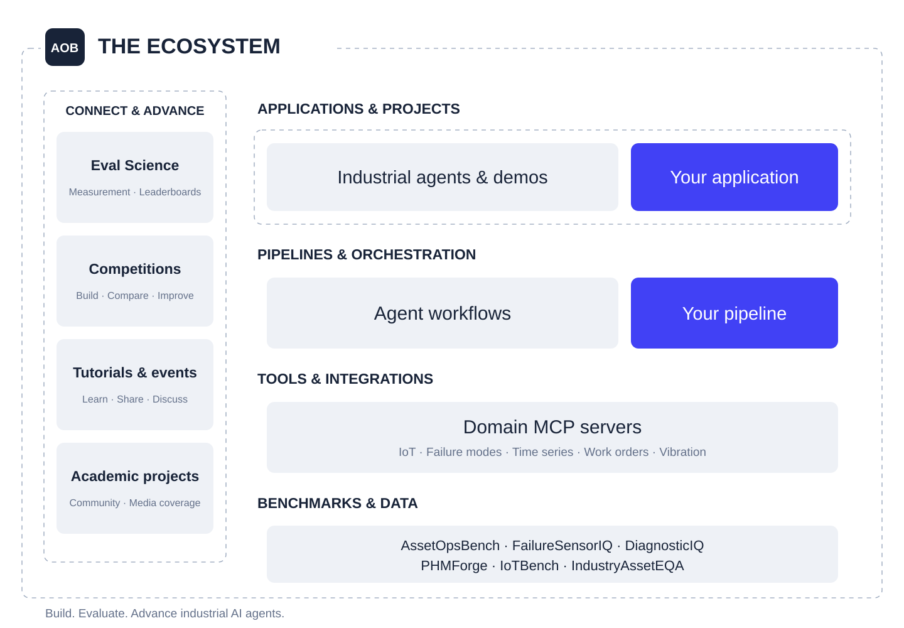

<div align="center">

# AssetOpsBench

### Build. Evaluate. Advance industrial AI agents.

An open ecosystem for industrial AI: data, tools, pipelines, leaderboards, competitions, evaluation science, and a growing research community.

[Explore the code](https://github.com/IBM/AssetOpsBench) · [Get the data](https://huggingface.co/datasets/ibm-research/AssetOpsBench) · [Read the paper](https://arxiv.org/abs/2506.03828) · [Try the tutorial](https://shuxinlin.github.io/assetopsbench-kdd-tutorial-2026/) · [Leaderboards](#leaderboards) · [Competitions](#competitions) · [Eval Science](#evaluation-science-from-benchmarks-to-deployment-evidence)

</div>

---

| Research papers¹ | Benchmark families | MCP servers | Competition editions | Dataset downloads² | Universities represented³ |
| :---: | :---: | :---: | :---: | :---: | :---: |
| **15** | **6** | **5 + 1** | **2** | **2,654 / last month** | **4** |

*November 9, 2026 snapshot. ¹ Core research table, including accepted papers and preprints. ² Across three Hugging Face dataset repositories. ³ In the listed academic-project directory. [Sources and counting rules](METRICS.md).*

Industrial intelligence begins with a practical question: **can an AI agent turn operational evidence into a reliable next step?**

AssetOpsBench brings that question into a reproducible environment. It connects sensor observations, failure knowledge, time-series analysis, and maintenance workflows so researchers and practitioners can build agents, inspect their decisions, and evaluate their performance. The research benchmark includes **141 expert-curated scenarios**, with **99 single-agent tasks and 42 tasks requiring multiple agents**. [Read the benchmark study →](https://arxiv.org/abs/2506.03828)

> **In the community:** Discussed by [LG AI Research](https://www.lgresearch.ai/blog/view?seq=633), featured in the [Codabench 2025 newsletter](https://docs.codabench.org/v1.24/Newsletters_Archive/CodaLab-in-2025/) and [The AI Report on KDnuggets](https://ai-report.kdnuggets.com/p/gemini-reads-your-mind-now), with discussions spanning [ACL Birds of a Feather](https://luma.com/jxdjefmv), [NeurIPS](https://neurips.cc/virtual/2025/loc/san-diego/social/129335), and [AAAI evaluation science](https://bench-to-evidence.github.io/).

## One ecosystem. Many ways to contribute.



| Explore | What you will find | Start here |
| :--- | :--- | :--- |
| **Datasets & benchmarks** | Operational scenarios, sensor–failure questions, and evaluation resources | [AssetOpsBench data](https://huggingface.co/datasets/ibm-research/AssetOpsBench) · [FailureSensorIQ data](https://huggingface.co/datasets/ibm-research/FailureSensorIQ) |
| **Tools & integrations** | Domain tools exposed through MCP for industrial workflows | [MCP server reference](https://github.com/IBM/AssetOpsBench/blob/main/docs/mcp-servers.md) |
| **Pipelines & orchestration** | Agent execution, planning, and evaluation workflows | [Setup and execution guide](https://github.com/IBM/AssetOpsBench/blob/main/INSTRUCTIONS.md) |
| **Papers & research** | Benchmark design, industrial reasoning, retrieval, planning, and deployed systems | [Research portfolio](#research-portfolio) |
| **Tutorials & learning** | Guided labs, notebooks, technical material, and conference tutorials | [Learning resources](#learn-by-building) |
| **Seminars & events** | Talks, workshops, demonstrations, and community gatherings | [Events and challenges](#events-and-challenges) |
| **Leaderboards** | Published comparisons and competition rankings, with their evaluation scope | [Compare systems](#leaderboards) |
| **Competitions** | Public challenges, participation resources, results, and retrospectives | [Explore challenges](#competitions) |
| **Evaluation science** | Measurement validity, diagnostics, and evidence for operational claims | [Benchmarks to evidence](#evaluation-science-from-benchmarks-to-deployment-evidence) |
| **Community voices & coverage** | Platform spotlights, newsletters, independent commentary, and announcements | [Around the community](#around-the-community) |
| **Projects & extensions** | Research collaborations and community experiments | [Community projects](#built-with-the-community) |
| **Applications & demos** | Examples of industrial agents and interactive evaluation | [AssetOpsBench-Live](https://ojs.aaai.org/index.php/AAAI/article/view/42372) |

## Quick Start

```bash
git clone https://github.com/IBM/AssetOpsBench.git
cd AssetOpsBench
pip install -e .
```

Follow [INSTRUCTIONS.md](INSTRUCTIONS.md) to configure services and run a documented agent workflow. You can also explore the [Hugging Face playground](https://huggingface.co/spaces/ibm-research/AssetOps-Bench) or the [Colab notebook](https://colab.research.google.com/github/IBM/AssetOpsBench/blob/main-0.x/notebook/LLM_Agent.ipynb).

Active development is on `main`. Publication-specific code is maintained on branches including [`IndustryAssetEQA`](https://github.com/IBM/AssetOpsBench/tree/IndustryAssetEQA) and [`main-0.x`](https://github.com/IBM/AssetOpsBench/tree/main-0.x).

## From operational evidence to evaluated action

The current repository exposes five domain MCP servers—**IoT, failure modes, time-series analysis, work orders, and vibration**—plus shared utilities. Its agent implementations include Plan Execute, Deep Agent, Claude Agent, and OpenAI Agent. Explore their interfaces and configuration in the [repository](https://github.com/IBM/AssetOpsBench) and [server documentation](https://github.com/IBM/AssetOpsBench/blob/main/docs/mcp-servers.md).

Together, these components support a research workflow:

1. **Choose a task** grounded in asset operations.
2. **Connect the evidence** through domain tools and data interfaces.
3. **Run an agent or pipeline** and record its trajectory.
4. **Evaluate the result** against the scenario's expected behavior.
5. **Investigate failures** and share improvements others can reproduce.

The [KDD hands-on tutorial](https://shuxinlin.github.io/assetopsbench-kdd-tutorial-2026/) walks through this process, from MCP tools to a grounded work-order agent and an auditable leaderboard.

## A family of industrial AI benchmarks

AssetOpsBench connects complementary research questions across industrial operations. Each benchmark has its own task, release, and evaluation protocol.

| Benchmark | The question it asks | Explore |
| :--- | :--- | :--- |
| **AssetOpsBench** | Can agents coordinate tools and evidence to complete industrial operations tasks? | [Paper](https://arxiv.org/abs/2506.03828) · [Data](https://huggingface.co/datasets/ibm-research/AssetOpsBench) |
| **FailureSensorIQ** | Can models reason about relationships between failure modes and sensors? | [Paper](https://arxiv.org/abs/2506.03278) · [Data](https://huggingface.co/datasets/ibm-research/FailureSensorIQ) |
| **DiagnosticIQ** | Given a triggered symbolic rule, can a model recommend the appropriate maintenance action? | [Paper](https://arxiv.org/abs/2605.08614) |
| **PHMForge** | Can agents select and sequence algorithm-grounded tools for prognostics and health management? | [Paper](https://arxiv.org/abs/2604.01532) · [Data and datasheet](https://huggingface.co/datasets/ibm-research/PHMForge) |
| **IoTBench / ReActXen** | Can language agents retrieve the right industrial sensor data? | [Published study](https://aclanthology.org/2025.emnlp-industry.24/) |
| **IndustryAssetEQA** | Can industrial explanations be grounded in telemetry and failure knowledge? | [Published study](https://aclanthology.org/2026.acl-industry.49/) |

**DiagnosticIQ** comprises 6,690 multiple-choice questions derived from 118 expert-authored rule–action pairs across 16 asset types. Its five variants probe distractor pressure, surface changes, prose formulations, condition inversion, and rationales. The October 2026 paper evaluates 29 LLMs and four embedding baselines. [DiagnosticIQ v2](https://arxiv.org/abs/2605.08614v2)

**PHMForge** pairs 99 scenarios across eight asset classes with 39 MCP-native tools in the August 2026 paper. The current dataset card provides separate rotating/aero and lithium-ion configurations and documents overlap with the AssetOpsBench PHM release, so their counts should not be added as independent tasks. [PHMForge paper](https://arxiv.org/abs/2604.01532v3) · [Dataset card](https://huggingface.co/datasets/ibm-research/PHMForge)

The team has [announced NeurIPS 2026 acceptance for DiagnosticIQ and PHMForge](https://www.linkedin.com/posts/devinyasithdesilva_github-ibmassetopsbench-assetopsbench-activity-7509303817298124800-nDY8); PHMForge's dataset card identifies the Evaluations & Datasets track. These are acceptance announcements, distinct from records of conference presentations already delivered.

## Open data for industrial intelligence

| Resource | Research focus | Access |
| :--- | :--- | :--- |
| **AssetOpsBench** | Task-oriented evaluation of industrial agents; the paper describes a 141-scenario benchmark | [Dataset](https://huggingface.co/datasets/ibm-research/AssetOpsBench) · [Paper](https://arxiv.org/abs/2506.03828) |
| **DiagnosticIQ** | Rule-to-action maintenance recommendation, with targeted robustness variants | [Paper and benchmark specification](https://arxiv.org/abs/2605.08614) · [Author-maintained code](https://github.com/DevinDeSilva/DiagnosticIQ) |
| **PHMForge** | Industrial prognostics and health management; 99 scenarios in the current dataset card | [Dataset](https://huggingface.co/datasets/ibm-research/PHMForge) · [Paper](https://arxiv.org/abs/2604.01532) |
| **FailureSensorIQ** | Sensor–failure reasoning: 8,296 multiple-choice questions across 10 industrial asset types | [Dataset](https://huggingface.co/datasets/ibm-research/FailureSensorIQ) · [Code and evaluation](https://github.com/IBM/FailureSensorIQ) |
| **IoTBench / ReActXen** | Natural-language industrial data access: 400+ tasks across five industrial sites, described in the associated paper | [Paper](https://aclanthology.org/2025.emnlp-industry.24/) · [Repository](https://github.com/IBM/ReActXen) |
| **IndustryAssetEQA resources** | Telemetry-grounded question answering with a failure-mode knowledge graph; evaluated across four asset types | [Paper](https://arxiv.org/abs/2604.23446) · [Code, datasets, and graph](https://github.com/IBM/AssetOpsBench/tree/IndustryAssetEQA/IndustryAssetEQA) |
| **Industrial embedding datasets** | Nine asset-specific retrieval datasets constructed for the embedding study | [Published study](https://aclanthology.org/2025.emnlp-industry.155/) · [Implementation](https://github.com/IBM/FailureSensorIQ/tree/main/LLM-Embeddings) |

**Use the version that matches your experiment.** Dataset repositories evolve: the Hugging Face scenario viewer showed 152 rows when reviewed, while the benchmark paper reports 141 curated scenarios. Record the dataset revision, configuration, and code commit when reporting results. [Dataset viewer →](https://huggingface.co/datasets/ibm-research/AssetOpsBench)

<a id="publications"></a>

## Research impact: datasets in use

**From released data to new models, tools, and experiments.** Researchers and developers use the family to study industrial reasoning, train smaller models, test security and robustness, and build new evaluation systems.

| Use | Examples and evidence |
| :--- | :--- |
| **Secure multi-agent systems** | [Multi-CaMeL](https://arxiv.org/abs/2610.05640), with **Ilia Shumailov** (AI Sequrity Company) and **Christian Schroeder de Witt** (Oxford), evaluates agent utility on AOB. Its attack-success tests use another benchmark. |
| **A new industrial data layer** | **VaidhyaMegha / Samyama's Madhulatha Mandarapu and Sandeep Kunkunuru** [build and evaluate a graph extension](https://arxiv.org/abs/2605.26874) over AOB scenarios, with [released code](https://github.com/samyama-ai/assetops-kg). |
| **Fine-tuning and retrieval** | [Damarla and Zhu](https://arxiv.org/abs/2607.24824) and [Industrial-Instruction](https://arxiv.org/abs/2608.22817), co-authored by **Moharram Challenger**, evaluate on FailureSensorIQ. Community releases include a [Qwen3-4B LoRA adapter](https://huggingface.co/predictive-maintenance/qwen3-4b-failuresensoriq-lora) and an [ASTRIS reranker](https://huggingface.co/DestinyOtto/astris-minilm-l6-assetops-reranker) trained on selected AOB examples. |
| **Community robustness experiments** | Or4k2!'s [Kaggle notebook](https://www.kaggle.com/code/orecord/lost-in-the-middle-benchmark) uses FailureSensorIQ for position/distractor experiments; **Siddharth Srinivasan's** [local-model study](https://www.industrialmindandcode.ai/blog/small-language-models-fault-diagnosis.html) examines accuracy and output usability. |
| **Multi-agent industrial reasoning** | [Gong, Qiao and colleagues](https://doi.org/10.1016/j.jii.2025.101012) evaluate a modular multi-agent framework on FailureSensorIQ. **Sadamori Kojaku's** [teams4industry project](https://github.com/skojaku/teams4industry/blob/main/libs/teams/teams/benchmarks/__init__.py) provides a single-answer dataset adapter. |
| **Downstream tools and benchmarks** | [FedProC](https://fedproc.readthedocs.io/en/latest/datasets/) integrates AOB telemetry; [Faraday Industrial Benchmark](https://github.com/Faraday-Cage-AI/faraday-industrial-benchmark/blob/main/third_party/manifest.json) preserves an attributed AOB snapshot; a [community PHMForge adapter](https://github.com/zyqzyq007/phmforge-research-adapter) supports partial research adaptations. |

See the [research-use register](RESEARCH_USE.md) for study versions, affiliations, connected versus external work, and limits of each claim. Released artifacts and publisher-reported experiments are verified here; downstream training and evaluations were not rerun. Citations and company discussion are recorded in the [citation audit](CITATION_AUDIT.md) and [coverage inventory](COVERAGE_AND_EVENTS.md).

## Research portfolio

The portfolio below brings together AssetOpsBench and related work from its team. Tutorials, bridge contributions, and workshop material are identified separately from research papers.

### Benchmarks, operational systems, and reasoning

| Venue | Work | Contribution |
| :--- | :--- | :--- |
| **NeurIPS 2026 · Acceptance announced** | [DiagnosticIQ: A Benchmark for LLM-Based Industrial Maintenance Action Recommendation from Symbolic Rules](https://arxiv.org/abs/2605.08614) | Symbolic rule-to-action evaluation; [author announcement](https://www.linkedin.com/posts/devinyasithdesilva_github-ibmassetopsbench-assetopsbench-activity-7509303817298124800-nDY8) |
| **NeurIPS 2026 · Evaluations & Datasets, per dataset card** | [PHMForge: Evaluating LLM Agents on Industrial Prognostics through MCP-Native, Algorithm-Grounded Tools](https://arxiv.org/abs/2604.01532) | Algorithm-grounded PHM tools and scenarios; [release record](https://huggingface.co/datasets/ibm-research/PHMForge) |
| **2026 · Preprint** | [Beyond Static Leaderboards: Predictive Validity for the Evaluation of LLM Agents](https://arxiv.org/abs/2606.19704) | Synthesis of implementation studies and a proposed measurement framework |
| **2026 · Preprint** | [Results and Retrospective Analysis of the CODS 2025 AssetOpsBench Challenge](https://arxiv.org/abs/2605.08518) | Competition results and evaluation-methodology analysis |
| **KDD 2026 · Datasets & Benchmarks** | [AssetOpsBench](https://arxiv.org/abs/2506.03828) | A reproducible environment for industrial agent evaluation; venue acceptance is listed in the [project](https://github.com/IBM/AssetOpsBench#publications) |
| **ACL 2026 · Industry** | [IndustryAssetEQA: A Neurosymbolic Operational Intelligence System for Embodied Question Answering in Industrial Asset Maintenance](https://arxiv.org/abs/2604.23446) | Connects telemetry representations and failure knowledge for grounded explanations |
| **ICLR 2026** | [Adaptive Conformal Anomaly Detection with Time Series Foundation Models for Signal Monitoring](https://proceedings.iclr.cc/paper_files/paper/2026/hash/f54c9fc57aa6e1c72400cc127917fcf8-Abstract-Conference.html) | Adaptive anomaly scores using pretrained forecasting models |
| **AAAI 2026 · Demonstration** | [AssetOpsBench-Live: Privacy-Aware Online Evaluation of Multi-Agent Performance in Industrial Operations](https://ojs.aaai.org/index.php/AAAI/article/view/42372) | Containerized submissions evaluated on hidden scenarios with diagnostic feedback |
| **AAAI 2026** | [SPIRAL: Symbolic LLM Planning via Grounded and Reflective Search](https://ojs.aaai.org/index.php/AAAI/article/view/40975) | Symbolic planning with grounded and reflective search |
| **IAAI 2026 · Deployed Applications** | [Deployed AI Agents for Industrial Asset Management: CodeReAct Framework for Event Analysis and Work Order Automation](https://ojs.aaai.org/index.php/AAAI/article/view/41453) | Event analysis and work-order automation in operational facilities |
| **IAAI 2026** | [Diversity Meets Relevancy: Multi-Agent Knowledge Probing for Industry 4.0 Applications](https://ojs.aaai.org/index.php/AAAI/article/view/41459) | Multi-agent generation and refinement of domain-relevant questions |
| **NeurIPS 2025 · Datasets & Benchmarks** | [FailureSensorIQ: A Multi-Choice QA Dataset for Understanding Sensor Relationships and Failure Modes](https://arxiv.org/abs/2506.03278) | Evaluation of industrial knowledge and sensor–failure reasoning |
| **EMNLP 2025 · Industry** | [ReAct Meets Industrial IoT: Language Agents for Data Access](https://aclanthology.org/2025.emnlp-industry.24/) | ReActXen agents and IoTBench for industrial data access |
| **EMNLP 2025 · Industry** | [Generalized Embedding Models for Industry 4.0 Applications](https://aclanthology.org/2025.emnlp-industry.155/) | Retrieval models adapted to industrial asset semantics |
| **EMNLP 2025 · Findings** | [Fine-Tuned Thoughts: Leveraging Chain-of-Thought Reasoning for Industrial Asset Health Monitoring](https://aclanthology.org/2025.findings-emnlp.1126/) | Specialized reasoning for industrial health monitoring |

### Tutorials, bridge, and workshop contributions

- **AAAI 2027 hands-on lab:** [A Hands-on Lab on Agentic Scientific Discovery for Time Series with the Model Context Protocol](https://ibm.github.io/AssetOpsBench/). The project page lists a 3.5-hour, five-sprint program; session date, venue, and registration are pending. [University preprint record](https://scholarcommons.sc.edu/aii_fac_pub/643/).
- **KDD 2026 hands-on tutorial:** [Building Reliable Industrial Agents with MCP: A Hands-on AssetOpsBench Tutorial for AI-Driven Operations](https://shuxinlin.github.io/assetopsbench-kdd-tutorial-2026/). Also listed in the [official tutorial program](https://kdd2026.kdd.org/tutorials/).
- **AAAI 2026 tutorial:** [From Inception to Productization: Hands-on Lab for the Lifecycle of Multimodal Agentic AI in Industry 4.0](https://research.ibm.com/publications/from-inception-to-productization-hands-on-lab-for-the-lifecycle-of-multimodal-agentic-ai-in-industry-40).
- **AAAI 2026 bridge contribution:** [Knowledge-Guided AI for Industrial Asset Health Monitoring](https://sites.google.com/stevens.edu/kgml-bridge-aaai-26).
- **AAAI 2026 workshop contribution:** [Agentic Code Generation for Heuristic Rules in Equipment Monitoring](https://underline.io/lecture/143674-agentic-code-generation-for-heuristic-rules-in-equipment-monitoring).

## Learn by building

**Explore the AAAI 2027 lab.** The [time-series scientific-discovery lab](https://ibm.github.io/AssetOpsBench/) introduces TSM-MCP-Kit, an sktime-backed MCP server, through evidence inspection, recipe composition, diagnostic refinement, evaluation, and search. Lab materials are being released in stages; consult the site for availability.

**Start with a guided lab.** The [KDD tutorial](https://shuxinlin.github.io/assetopsbench-kdd-tutorial-2026/) covers environment setup, industrial MCP tools, agent execution, and evaluation.

**Explore the underlying techniques.** Study the [ReActXen IoT agent tutorial](https://github.com/IBM/ReActXen/blob/main/docs/tutorial/ReActXen_IoT_Agent_EMNLP_2025.pdf), [FailureSensorIQ evaluation code](https://github.com/IBM/FailureSensorIQ), and [AssetOpsBench technical material](https://github.com/IBM/AssetOpsBench/blob/main/docs/tutorial/AssetOpsBench_Technical_Material.pdf).

**Connect research to implementation.** Follow the [setup instructions](https://github.com/IBM/AssetOpsBench/blob/main/INSTRUCTIONS.md), select a documented pipeline, and retain its configuration alongside your results.

## Leaderboards

**Find the comparison that matches your question.** Model knowledge, agent execution, and competition rankings measure different capabilities.

| Comparison | What it measures | Explore |
| :--- | :--- | :--- |
| **Kaggle AssetOpsBench leaderboard** | The page currently describes FailureSensorIQ multiple-choice evaluation across 10 industrial asset types; broader agentic evaluation is described as future work | [Leaderboard and scope](https://www.kaggle.com/benchmarks/ibm-research/asset-ops-bench) |
| **DiagnosticIQ research leaderboard** | Maintenance-action recommendation and variant robustness; published tables rather than a verified standalone live service | [Paper and score definitions](https://arxiv.org/html/2605.08614v2#S5.SS1) |
| **PHMForge research comparisons** | Framework/model configurations on PHM scenarios; the paper reports a public leaderboard | [Paper](https://arxiv.org/abs/2604.01532) · [Dataset release](https://huggingface.co/datasets/ibm-research/PHMForge) |
| **CODS competition rankings** | Submitted systems evaluated in planning and execution tracks, including public and hidden evaluation | [Codabench competition](https://www.codabench.org/competitions/10206/) · [Results analysis](https://arxiv.org/abs/2605.08518) |
| **Reproducible tutorial leaderboard** | Agent outputs evaluated against static scenario data in a guided workflow | [KDD tutorial](https://shuxinlin.github.io/assetopsbench-kdd-tutorial-2026/) · [Evaluation documentation](https://ibm.github.io/AssetOpsBench/docs/static-json-evaluation.html) |

Read scores alongside the dataset revision, model configuration, track, and scoring protocol. The [CODS retrospective](https://arxiv.org/abs/2605.08518) shows why: public scores and hidden execution scores had a correlation of −0.13 in its analyzed sample, and changing the scaling of one composite-score term would exchange the top two teams. A ranking is meaningful only with its measurement context.

<a id="ai-competitions"></a>

## Competitions

**Build an agent. Test it under shared conditions. Learn from the failures.** Public challenges turn the ecosystem into a place to experiment, compare approaches, and contribute reproducible evidence.

### CODS 2025 · AssetOpsBench-Live

The challenge invited teams to develop industrial agents across sensing, reasoning, and action, including maintenance diagnosis and work-order tasks. Its planning and execution tracks are analyzed in the subsequent retrospective. [Official conference challenge page](https://ikdd.acm.org/cods-2025/data-challenge.php) · [Codabench platform](https://www.codabench.org/competitions/10206/)

The official schedule listed a **November 13, 2025 submission deadline** and **December 20 award ceremony**. The later [retrospective](https://arxiv.org/abs/2605.08518) examines a specific 300-attempt server log and 149 registered teams. These scoped counts should be kept distinct from broader participation totals reported in other project publications.

### IJCAI 2026 · Industrial Automation Challenge

Hosted on **Kaggle** by the organizing team, the challenge explores physics-grounded industrial reasoning. Track 1 evaluates internal model reasoning in a closed-book setting, with maintenance and failure-analysis questions. Its listed submission window was **June 15–August 18, 2026**. [Challenge hub](https://sites.google.com/view/ai-industrial-challenge-ijcai/home) · [Track 1](https://www.kaggle.com/competitions/industrial-automation-challenge-track-1/) · [IJCAI competition directory](https://2026.ijcai.org/competitions/)

### Competition research

[Results and Retrospective Analysis of the CODS 2025 AssetOpsBench Challenge](https://arxiv.org/abs/2605.08518), a 2026 preprint, studies leaderboard behavior, hidden evaluation, scoring scales, participation, and submitted strategies. It complements the [AAAI AssetOpsBench-Live system paper](https://ojs.aaai.org/index.php/AAAI/article/view/42372): one describes the platform; the other investigates what the competition actually measured.

## Evaluation science: from benchmarks to deployment evidence

**What does a benchmark score justify saying about an agent in an operational setting?** This question connects benchmark development with measurement research and deployment practice.

### Research foundation

[Beyond Static Leaderboards: Predictive Validity for the Evaluation of LLM Agents](https://arxiv.org/abs/2606.19704), a June 2026 preprint, synthesizes fourteen parallel implementation studies and argues for evaluating whether rankings transfer beyond their original test conditions. It proposes testable predictive-validity criteria and explicitly notes that existing evidence is insufficient to confirm the position.

### AAAI-27 Bridge · From Agent Benchmarks to Deployment Evidence

The [Bridge website](https://bench-to-evidence.github.io/) lists **Bridging Evaluation Science and Deployment Practice** for **February 16–17, 2027, in Montréal, Canada**. As of this overview's review date, this is an **upcoming activity**, with planned outputs.

The program brings benchmark builders and measurement researchers together with workflow owners, domain experts, and practitioners. Its industrial-maintenance case uses a configured agent in the AssetOpsBench simulated environment; a second case addresses software engineering. Participants will derive deployment criteria, inspect evaluation evidence, identify missing failure checks, and specify what a supervised pilot must still establish. [Program and cases](https://bench-to-evidence.github.io/#cases)

Planned outputs include **two worked case audits and a versioned protocol draft**, building on PREP-Eval and mapping to existing benchmark assessment frameworks. The page lists **December 1, 2026** for case or interest statements. [Participation and dates](https://bench-to-evidence.github.io/#participation)

This gives evaluation science a visible place in the ecosystem: connecting scenarios, scoring, diagnostics, and operational claims. The competition retrospective supplies a concrete example of why that connection matters. [CODS evaluation analysis](https://arxiv.org/abs/2605.08518)

<a id="talks--events"></a>

## Events and challenges

### Public engagement

| When | Event or activity | Explore |
| :--- | :--- | :--- |
| **AAAI 2027 · Session details pending** | Hands-on lab on agentic scientific discovery for time series with MCP | [Project site](https://ibm.github.io/AssetOpsBench/) · [University preprint record](https://scholarcommons.sc.edu/aii_fac_pub/643/) |
| **February 16–17, 2027 · Upcoming** | AAAI-27 Bridge: From Agent Benchmarks to Deployment Evidence · Montréal | [Eval Science program](https://bench-to-evidence.github.io/) |
| **August 11, 2026** | KDD hands-on MCP tutorial · Jeju, South Korea | [Tutorial and materials](https://shuxinlin.github.io/assetopsbench-kdd-tutorial-2026/) |
| **July 7, 2026** | ACL BoF: What Makes an Enterprise Agent Benchmark Useful? Tasks, Tools & Trust · San Diego | [Event page](https://luma.com/jxdjefmv) |
| **June 25, 2026** | Open Source Responsible AI Meetup: AssetOpsBench lightning talk/demo · St John’s University, New York | [Meetup agenda](https://luma.com/j4upg6c2) |
| **2026 competition edition** | IJCAI Industrial Automation Challenge: physics-grounded industrial reasoning | [Official competitions](https://2026.ijcai.org/competitions/) · [Challenge site](https://sites.google.com/view/ai-industrial-challenge-ijcai/home) |
| **January 2026** | AAAI / IAAI research, demonstration, tutorial, and bridge activities · Singapore | [Demo program](https://aaai.org/conference/aaai/aaai-26/aaai-26-demonstration-program/) · [Tutorial](https://research.ibm.com/publications/from-inception-to-productization-hands-on-lab-for-the-lifecycle-of-multimodal-agentic-ai-in-industry-40) |
| **AAAI 2026** | AI4TS keynote by Nianjun Zhou: AssetOpsBench for time series and event-driven industrial operations | [Workshop program](https://ai4ts.github.io/aaai2026) |
| **January 20, 2026** | NUS seminar by Dhaval Patel on AssetOpsBench and industrial task automation | [University event listing](https://events.comp.nus.edu.sg/view/25423) |
| **December 4, 2025** | NeurIPS social talk: Building Reliable Agentic Benchmarks: Insights from AssetOpsBench · San Diego | [Conference listing](https://neurips.cc/virtual/2025/loc/san-diego/social/129335) · [Talk agenda](https://luma.com/mkyyvypm) |
| **October 3, 2025** | NJIT ACM workshop: AI Agents and Their Role in Industry 4.0 Applications | [Project event record](https://github.com/IBM/AssetOpsBench#talks--events) |
| **September 2025** | CODS AssetOpsBench-Live competition launch | [Competition](https://www.codabench.org/competitions/10206/) · [Platform paper](https://ojs.aaai.org/index.php/AAAI/article/view/42372) |

**Competition archives are research resources, too.** The benchmark study reports **500+ agent submissions** to the public competition platform. The IJCAI challenge's [Track 1 page](https://www.kaggle.com/competitions/industrial-automation-challenge-track-1/) lists June 15–August 18, 2026; consult each track's page for its own dates and access details. [Benchmark study →](https://arxiv.org/abs/2506.03828)

<a id="university-projects--extensions"></a>

## Built with the community

### Academic projects & university collaborations

| University | Listed project areas | Explore |
| :--- | :--- | :--- |
| **Columbia University** | HPML research projects, pipeline optimization, visual inspection, reusable skills, and PHM | [Instructor account](https://kaoutarelmaghraoui.com/blog/hpml-industrial-mentorship-arxiv/) · [Project directory](docs/university-projects.md) |
| **University at Albany** | SPIN: structured planning and execution efficiency | [Paper](https://arxiv.org/abs/2605.14051) |
| **Binghamton University** | Confidence-aware coordination and abstention | [Project directory](docs/university-projects.md) |
| **University of Technology Sydney** | Agentic workflows for naval operations and maintenance | [Project directory](docs/university-projects.md) |

These names identify affiliations of listed projects; the directory is not an institutional endorsement or a complete count of every academic affiliation in the research portfolio.

AssetOpsBench also provides a foundation for collaborative research. These linked community papers explore complementary directions; their publication status and results should be read in their own sources.

| Direction | Community paper |
| :--- | :--- |
| Planning efficiency | [SPIN: Structural LLM Planning via Iterative Navigation for Industrial Tasks](https://arxiv.org/abs/2605.14051) |
| Scenario expansion | [Synthetic Scenario Generation for Evaluation of Industry 4.0 Agents](https://arxiv.org/abs/2607.22563) |
| Pipeline optimization | [Evaluating Temporal Semantic Caching and Workflow Optimization in Agentic Plan-Execute Pipelines](https://arxiv.org/abs/2605.20630) |
| Conversational operations | [Towards Multi-Turn Dialog Systems for Industrial Asset Operations and Maintenance](https://arxiv.org/abs/2605.24953) |
| Knowledge infrastructure | [Knowledge Graphs as the Missing Data Layer for LLM-Based Industrial Asset Operations](https://arxiv.org/abs/2605.26874) |

The broader [project directory](docs/university-projects.md) includes work on visual inspection, battery analytics, skills and knowledge plugins, smaller models, time-series performance, and additional industrial domains.

## Around the community

AssetOpsBench is appearing in benchmarking communities, newsletters, external directories, and practitioner discussion. These sources show different kinds of engagement: a platform spotlight, a research mention, or an external review each tells its own story.

### Platform spotlights and newsletters

- **The AI Report on KDnuggets · January 27, 2026:** the issue includes a section on AssetOpsBench and industrial multi-agent coordination. [Read the issue](https://ai-report.kdnuggets.com/p/gemini-reads-your-mind-now).
- **Agent Brief · August 13 and September 9, 2026:** discusses AssetOpsBench in the broader move toward domain-specific evaluation and operational evidence. [August issue](https://news.agentcommunity.org/issues/2026-08-13-cheap-models-standardized) · [September issue](https://news.agentcommunity.org/issues/2026-09-09-trust-standards-and).

- **Codabench's 2025 year-in-review newsletter** includes AssetOpsBench in its industrial-applications spotlight, describing the challenge's coverage from sensing through reasoning to action. [Read the newsletter](https://docs.codabench.org/v1.24/Newsletters_Archive/CodaLab-in-2025/).
- **The June 9, 2025 “Daily Paper” newsletter archive** includes the AssetOpsBench paper and a short research summary. This is a newsletter mention; the archive alone does not establish an official Hugging Face endorsement. [Read the archived issue](https://groups.google.com/g/hf-daily-paper-newsletter/c/_JxXFToQ3A8).

### External coverage and perspectives

| Source | What it contributes |
| :--- | :--- |
| [LG AI Research: AEGIS](https://www.lgresearch.ai/blog/view?seq=633) | Dongmin Kim’s March 18, 2026 research blog discusses AOB and its live demonstration, and considers future evaluation on the benchmark |
| [Sharan Harsoor on Medium](https://medium.com/@sharanharsoor/ai-learned-to-write-code-it-never-learned-to-hold-a-wrench-a87fb68f3552) | An October 14, 2026 article focused on AssetOpsBench, industrial tool orchestration, and the distinction between benchmark evidence and deployment claims |
| [Siarhei Krupenich on Medium](https://medium.com/@siarhei.krupenich/putting-assetopsbench-to-the-test-an-ai-agent-adventure-74ab67121e72) | An August 19, 2025 introductory article about the framework and its industrial-agent motivation |
| [HysenLabs](https://hysenlabs.com/projects/ibm-assetopsbench) | An external review of MCP tools, orchestration, documentation, and adoption considerations |
| [Joshua Berkowitz](https://joshuaberkowitz.us/blog/news-1/assetopsbench-sets-new-standards-for-ai-in-industrial-asset-management-670) | Commentary on industrial-agent benchmarking and reliability |
| [Industrial Atlas](https://www.indatlas.com/datasets/assetopsbench/) | An external dataset-directory entry describing AssetOpsBench's industrial operations focus |
| [Mahal Systems benchmark catalog](https://mahalsystems.ai/aot/evals/benchmarks/assetopsbench/) | Practitioner-oriented discussion of the sandbox and architecture comparison, alongside caveats about counts, scoring, and leaderboard status |
| [Lancartech retrospective](https://lancartech.co.id/en/blog/assetopsbench-ibm-retrospektif-evaluasi-agent-industri) | External commentary on local debugging, score interpretation, and the limits of transferring benchmark results to deployments |

These are attributed perspectives, not validation of every claim they contain. Read each review against the release and evaluation protocol it discusses.

### Academic collaborators and extension contributors

For named course mentors, project participants, and benchmark co-authors, see the [contribution records](docs/university-projects.md#named-contributions-and-evidence). External research use and citations are documented separately in the [research-use register](RESEARCH_USE.md).

### Education and practitioner perspectives

[Kaoutar El Maghraoui’s account of industrial mentorship in Columbia’s HPML course](https://kaoutarelmaghraoui.com/blog/hpml-industrial-mentorship-arxiv/) describes how AssetOpsBench supplied open research problems for student teams. This is a collaborator’s account of the educational work. Company discussion also includes **LG AI Research, EQUA AI, and Lancartech**, alongside external reviews such as HysenLabs. These are coverage records, not adoption claims. Separately, [EQUA’s autonomy guide](https://equa.work/resources/grading-the-autonomy-claim) and [work-order data guide](https://equa.work/resources/work-order-history-what-it-can-do) cite AssetOpsBench in practitioner discussions of maintenance AI evidence.

### Project news

IBM’s own coverage includes the [project introduction](https://research.ibm.com/blog/asset-ops-benchmark), the [December 2, 2025 IBM–Kaggle leaderboard announcement](https://research.ibm.com/blog/ibm-kaggle-leaderboards-enterprise-ai), and the [January 21, 2026 Hugging Face blog](https://huggingface.co/blog/ibm-research/assetopsbench-playground-on-hugging-face).

### Conversations with the benchmarking community

The team also communicates directly through the Codabench community forum:

- [September 1, 2025: challenge announcement](https://groups.google.com/g/codalab-competitions/c/qaU5-1eDvaQ).
- [November 26, 2025: NeurIPS talk announcement on using Codabench for AssetOpsBench](https://groups.google.com/g/codalab-competitions/c/B_o6adf8nfo).

These posts document team outreach. Community research extensions appear in the project directory above; they provide a further view of how others build on the ecosystem.

See the [coverage and events inventory](COVERAGE_AND_EVENTS.md) for additional media mentions, conference records, directories, attribution notes, and unresolved leads.

## Bring your next industrial AI idea

- **Researchers:** evaluate a new reasoning method, retrieval system, planner, or agent architecture.
- **Engineers:** explore a documented workflow and contribute a reproducible integration.
- **Educators and students:** use the labs as a starting point for a course or research project.
- **Domain experts:** help create scenarios that capture operational context and meaningful success criteria.

Explore the [contribution guide](https://github.com/IBM/AssetOpsBench/blob/main/CONTRIBUTING.md), browse [open issues](https://github.com/IBM/AssetOpsBench/issues), or propose a new scenario.

---

*Reviewed November 9, 2026. This overview inventories resources identified through the public AssetOpsBench repository and linked primary sources. Paper titles and tracks follow publisher records where available. Repository-only event entries are linked to the project record; public listings may not capture every team activity.*


---

## Call for Scenario Contribution

We are expanding **AssetOpsBench** to cover a broader range of industrial challenges. We invite researchers and practitioners to contribute new scenarios, particularly in:

- **Asset Classes:** Turbines, HVAC systems, Pumps, Transformers, CNC Machines, Robotics, Engines
- **Task Domains:** Prognostics and Health Management, Remaining Useful Life (RUL) estimation, Root Cause Analysis (RCA), Diagnostic Analysis, Predictive Maintenance

**How to contribute:**

1. **Define** your scenario following our [Utterance Guideline](docs/guideline/utterance_design_guideline.md) and [Ground Truth Guideline](docs/guideline/ground_truth_design_guideline.md)
2. **Explore** the [Hugging Face dataset](https://huggingface.co/datasets/ibm-research/AssetOpsBench) for examples
   - For external public sources and starter asset-class mappings, see [External Industrial Dataset Guide](docs/external-industrial-datasets.md)
3. **Submit** a Pull Request or open an [Issue](https://github.com/IBM/AssetOpsBench/issues) with the tag `new-scenario`
4. **Contact us** with questions:
   - Dhaval Patel — [pateldha@us.ibm.com](mailto:pateldha@us.ibm.com)
   - Nianjun Zhou — [jzhou@us.ibm.com](mailto:jzhou@us.ibm.com)

---

## Infrastructure Support

Model API access for AssetOpsBench 2.0 is enabled by [TokenRouter](https://tokenrouter.com) (PaleBlueDot AI), a unified API platform providing access to leading AI models through a single API endpoint.

---

## Contributors

Thanks to these wonderful people ✨

<!-- ALL-CONTRIBUTORS-LIST:START - Do not remove or modify this section -->
<!-- prettier-ignore-start -->
<!-- markdownlint-disable -->
<table>
  <tbody>
    <tr>
      <td align="center" valign="top" width="14.28%">
        <a href="https://github.com/ShuxinLin">
          <br />
          <sub><b>ShuxinLin</b></sub>
        </a><br />
        <a href="https://github.com/IBM/AssetOpsBench/commits?author=ShuxinLin" title="Code">💻</a>
      </td>
      <td align="center" valign="top" width="14.28%">
        <a href="https://github.com/DhavalRepo18">
          <br />
          <sub><b>DhavalRepo18</b></sub>
        </a><br />
        <a href="https://github.com/IBM/AssetOpsBench/commits?author=DhavalRepo18" title="Code">💻</a>
      </td>
      <td align="center" valign="top" width="14.28%">
        <a href="https://github.com/ChathurangiShyalika">
          <br />
          <sub><b>ChathurangiShyalika</b></sub>
        </a><br />
        <a href="https://github.com/IBM/AssetOpsBench/commits?author=ChathurangiShyalika" title="Code">💻</a>
      </td>
      <td align="center" valign="top" width="14.28%">
        <a href="https://github.com/nianjunz">
          <br />
          <sub><b>nianjunz</b></sub>
        </a><br />
        <a href="https://github.com/IBM/AssetOpsBench/commits?author=nianjunz" title="Code">💻</a>
      </td>
      <td align="center" valign="top" width="14.28%">
        <a href="https://github.com/PUSHPAK-JAISWAL">
          <br />
          <sub><b>PUSHPAK-JAISWAL</b></sub>
        </a><br />
        <a href="https://github.com/IBM/AssetOpsBench/commits?author=PUSHPAK-JAISWAL" title="Code">💻</a>
      </td>
      <td align="center" valign="top" width="14.28%">
        <a href="https://github.com/LGDiMaggio">
          <br />
          <sub><b>LGDiMaggio</b></sub>
        </a><br />
        <a href="https://github.com/IBM/AssetOpsBench/commits?author=LGDiMaggio" title="Code">💻</a>
      </td>
      <td align="center" valign="top" width="14.28%">
        <a href="https://github.com/DeveloperMindset123">
          <br />
          <sub><b>Ayan Das</b></sub>
        </a><br />
        <a href="https://github.com/IBM/AssetOpsBench/commits?author=DeveloperMindset123" title="Code">💻</a>
      </td>
    </tr>
    <tr>
      <td align="center" valign="top" width="14.28%">
        <a href="https://github.com/jdsheehan">
          <br />
          <sub><b>jdsheehan</b></sub>
        </a><br />
        <a href="https://github.com/IBM/AssetOpsBench/commits?author=jdsheehan" title="Code">💻</a>
      </td>
      <td align="center" valign="top" width="14.28%">
        <a href="https://github.com/bradleyjeck">
          <br />
          <sub><b>bradleyjeck</b></sub>
        </a><br />
        <a href="https://github.com/IBM/AssetOpsBench/commits?author=bradleyjeck" title="Code">💻</a>
      </td>
      <td align="center" valign="top" width="14.28%">
        <a href="https://github.com/jtrayfield">
          <br />
          <sub><b>jtrayfield</b></sub>
        </a><br />
        <a href="https://github.com/IBM/AssetOpsBench/commits?author=jtrayfield" title="Code">💻</a>
      </td>
      <td align="center" valign="top" width="14.28%">
        <a href="https://github.com/florenzi002">
          <br />
          <sub><b>florenzi002</b></sub>
        </a><br />
        <a href="https://github.com/IBM/AssetOpsBench/commits?author=florenzi002" title="Code">💻</a>
      </td>
      <td align="center" valign="top" width="14.28%">
        <a href="https://github.com/flamehaven01">
          <br />
          <sub><b>flamehaven01</b></sub>
        </a><br />
        <a href="https://github.com/IBM/AssetOpsBench/commits?author=flamehaven01" title="Code">💻</a>
      </td>
      <td align="center" valign="top" width="14.28%">
        <a href="https://github.com/kushwaha001">
          <br />
          <sub><b>kushwaha001</b></sub>
        </a><br />
        <a href="https://github.com/IBM/AssetOpsBench/commits?author=kushwaha001" title="Code">💻</a>
      </td>
      <td align="center" valign="top" width="14.28%">
        <a href="https://github.com/Rohith-Kanathur">
          <br />
          <sub><b>Rohith-Kanathur</b></sub>
        </a><br />
        <a href="https://github.com/IBM/AssetOpsBench/commits?author=Rohith-Kanathur" title="Code">💻</a>
      </td>
    </tr>
    <tr>
      <td align="center" valign="top" width="14.28%">
        <a href="https://github.com/Mohit-15">
          <br />
          <sub><b>Mohit Gupta</b></sub>
        </a><br />
        <a href="https://github.com/IBM/AssetOpsBench/commits?author=Mohit-15" title="Code">💻</a>
      </td>
      <td align="center" valign="top" width="14.28%">
        <a href="https://github.com/jellyfishing2346">
          <br />
          <sub><b>jellyfishing2346</b></sub>
        </a><br />
        <a href="https://github.com/IBM/AssetOpsBench/commits?author=jellyfishing2346" title="Code">💻</a>
      </td>
      <td align="center" valign="top" width="14.28%">
        <a href="https://github.com/anncli">
          <br />
          <sub><b>anncli</b></sub>
        </a><br />
        <a href="https://github.com/IBM/AssetOpsBench/commits?author=anncli" title="Code">💻</a>
      </td>
      <td align="center" valign="top" width="14.28%">
        <a href="https://github.com/ozatamago">
          <br />
          <sub><b>ozatamago</b></sub>
        </a><br />
        <a href="https://github.com/IBM/AssetOpsBench/commits?author=ozatamago" title="Code">💻</a>
      </td>
      <td align="center" valign="top" width="14.28%">
        <a href="https://github.com/tomaspasie">
          <br />
          <sub><b>tomaspasie</b></sub>
        </a><br />
        <a href="https://github.com/IBM/AssetOpsBench/commits?author=tomaspasie" title="Code">💻</a>
      </td>
      <td align="center" valign="top" width="14.28%">
        <a href="https://github.com/Sans-Shej">
          <br />
          <sub><b>Sans-Shej</b></sub>
        </a><br />
        <a href="https://github.com/IBM/AssetOpsBench/commits?author=Sans-Shej" title="Code">💻</a>
      </td>
      <td align="center" valign="top" width="14.28%">
        <a href="https://github.com/sanjaiiv04">
          <br />
          <sub><b>sanjaiiv04</b></sub>
        </a><br />
        <a href="https://github.com/IBM/AssetOpsBench/commits?author=sanjaiiv04" title="Code">💻</a>
      </td>
    </tr>
    <tr>
      <td align="center" valign="top" width="14.28%">
        <a href="https://github.com/SajalGoyla">
          <br />
          <sub><b>SajalGoyla</b></sub>
        </a><br />
        <a href="https://github.com/IBM/AssetOpsBench/commits?author=SajalGoyla" title="Code">💻</a>
      </td>
      <td align="center" valign="top" width="14.28%">
        <a href="https://github.com/priyamDalmia">
          <br />
          <sub><b>priyamDalmia</b></sub>
        </a><br />
        <a href="https://github.com/IBM/AssetOpsBench/commits?author=priyamDalmia" title="Code">💻</a>
      </td>
      <td align="center" valign="top" width="14.28%">
        <a href="https://github.com/krishrveera">
          <br />
          <sub><b>krishrveera</b></sub>
        </a><br />
        <a href="https://github.com/IBM/AssetOpsBench/commits?author=krishrveera" title="Code">💻</a>
      </td>
      <td align="center" valign="top" width="14.28%">
        <a href="https://github.com/kmn01">
          <br />
          <sub><b>kmn01</b></sub>
        </a><br />
        <a href="https://github.com/IBM/AssetOpsBench/commits?author=kmn01" title="Code">💻</a>
      </td>
      <td align="center" valign="top" width="14.28%">
        <a href="https://github.com/Coderlicr">
          <br />
          <sub><b>Coderlicr</b></sub>
        </a><br />
        <a href="https://github.com/IBM/AssetOpsBench/commits?author=Coderlicr" title="Code">💻</a>
      </td>
      <td align="center" valign="top" width="14.28%">
        <a href="https://github.com/BrianBai093">
          <br />
          <sub><b>BrianBai093</b></sub>
        </a><br />
        <a href="https://github.com/IBM/AssetOpsBench/commits?author=BrianBai093" title="Code">💻</a>
      </td>
      <td align="center" valign="top" width="14.28%">
        <a href="https://github.com/AyalYakobe">
          <br />
          <sub><b>AyalYakobe</b></sub>
        </a><br />
        <a href="https://github.com/IBM/AssetOpsBench/commits?author=AyalYakobe" title="Code">💻</a>
      </td>
    </tr>
    <tr>
      <td align="center" valign="top" width="14.28%">
        <a href="https://github.com/amaan784">
          <br />
          <sub><b>amaan784</b></sub>
        </a><br />
        <a href="https://github.com/IBM/AssetOpsBench/commits?author=amaan784" title="Code">💻</a>
      </td>
      <td align="center" valign="top" width="14.28%">
        <a href="https://github.com/Dev-Scodes5">
          <br />
          <sub><b>Dev-Scodes5</b></sub>
        </a><br />
        <a href="https://github.com/IBM/AssetOpsBench/commits?author=Dev-Scodes5" title="Code">💻</a>
      </td>
      <td align="center" valign="top" width="14.28%">
        <a href="https://github.com/jack-pfeifer">
          <br />
          <sub><b>jack-pfeifer</b></sub>
        </a><br />
        <a href="https://github.com/IBM/AssetOpsBench/commits?author=jack-pfeifer" title="Code">💻</a>
      </td>
      <td align="center" valign="top" width="14.28%">
        <a href="https://github.com/sandeepkunkunuru">
          <br />
          <sub><b>sandeepkunkunuru</b></sub>
        </a><br />
        <a href="https://github.com/IBM/AssetOpsBench/commits?author=sandeepkunkunuru" title="Code">💻</a>
      </td>
      <td align="center" valign="top" width="14.28%">
        <a href="https://github.com/srutanik">
          <br />
          <sub><b>srutanik</b></sub>
        </a><br />
        <a href="https://github.com/IBM/AssetOpsBench/commits?author=srutanik" title="Code">💻</a>
      </td>
      <td align="center" valign="top" width="14.28%">
        <a href="https://github.com/thedgarg31">
          <br />
          <sub><b>thedgarg31</b></sub>
        </a><br />
        <a href="https://github.com/IBM/AssetOpsBench/commits?author=thedgarg31" title="Code">💻</a>
      </td>
      <td></td>
    </tr>
  </tbody>
</table>
<!-- markdownlint-restore -->
<!-- prettier-ignore-end -->
<!-- ALL-CONTRIBUTORS-LIST:END -->

---

## Star History

<a href="https://www.star-history.com/?repos=ibm%2Fassetopsbench&type=date&legend=top-left">
 <picture>
   <source media="(prefers-color-scheme: dark)" srcset="https://api.star-history.com/chart?repos=ibm/assetopsbench&type=date&theme=dark&legend=top-left" />
   <source media="(prefers-color-scheme: light)" srcset="https://api.star-history.com/chart?repos=ibm/assetopsbench&type=date&legend=top-left" />
   
 </picture>
</a>

---

<div align="center">

**If AssetOpsBench is useful to your work, please ⭐ star the repo, 🍴 fork it, and tell us what you're building.**

</div>

---

<div align="center">

[](https://mseep.ai/app/ibm-assetopsbench)
