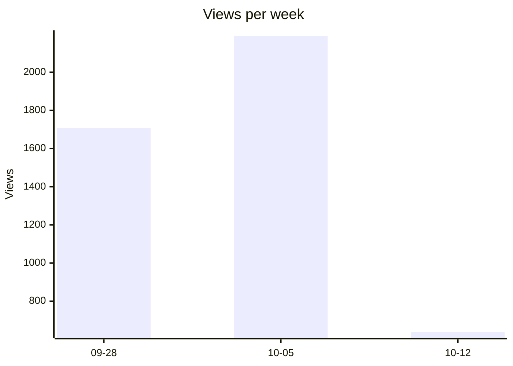
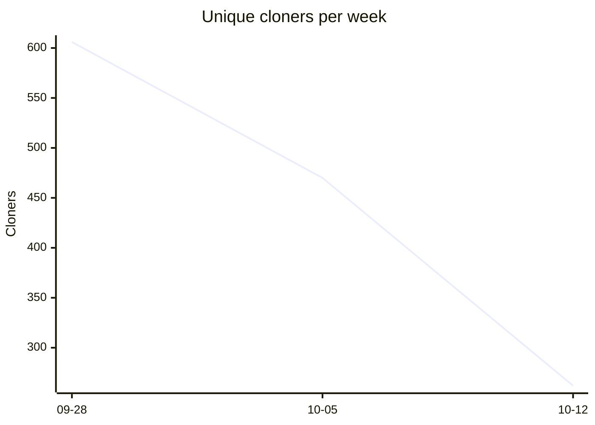
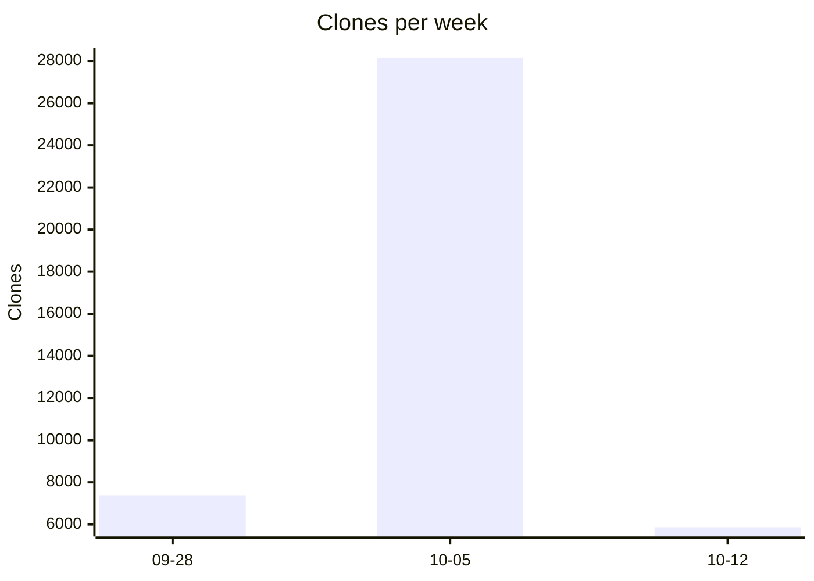

# Repository traffic

GitHub keeps traffic data for 14 days only; `scripts/traffic_stats.py` archives it into the CSVs in this folder. Daily unique counts do not add up to unique people over a period, and CI or mirrors inflate raw clones.

<!-- traffic:start -->
_Updated 2026-10-14 for `IBM/AssetOpsBench`. Archive covers 2026-09-30 to 2026-10-13. Weeks start Monday; the latest week may be partial._

| Metric | Archived total | Last 14 days |
|---|---:|---:|
| Views | 4,535 | 4,535 |
| Clones | 41,422 | 41,422 |
| Unique cloners (daily, summed) | 1,338 | 1,338 |

### Weekly views

### Weekly unique cloners

### Weekly clones

### Clone spikes

Days above 5x the median clone count; usually CI or mirror pulls.

- 2026-10-10: 25,353 clones from 72 cloners
- 2026-10-13: 4,994 clones from 224 cloners

### Top referrers (last 14 days)

| Referrer | Views | Unique |
|---|---:|---:|
| github.com | 161 | 120 |
| Google | 158 | 129 |
| linkedin.com | 45 | 36 |
| machinelearningforkids.co.uk | 30 | 30 |
| Bing | 27 | 21 |
| teams.public.onecdn.static.microsoft | 17 | 15 |
| ibm.com | 11 | 11 |
| com.linkedin.android | 11 | 9 |
| arxiv.org | 5 | 5 |
| chatgpt.com | 5 | 3 |

### Top pages (last 14 days)

| Path | Views | Unique |
|---|---:|---:|
| `/IBM/AssetOpsBench` | 1384 | 346 |
| `/IBM/AssetOpsBench/stargazers` | 398 | 1 |
| `/IBM/AssetOpsBench/pulls` | 295 | 19 |
| `/IBM/AssetOpsBench/issues` | 77 | 28 |
| `/IBM/AssetOpsBench/pulse` | 44 | 3 |
| `/IBM/AssetOpsBench/graphs/traffic` | 38 | 1 |
| `/IBM/AssetOpsBench/tree/main` | 36 | 20 |
| `/IBM/AssetOpsBench/discussions` | 34 | 6 |
| `/IBM/AssetOpsBench/tree/main/src` | 33 | 21 |
| `/IBM/AssetOpsBench/tree/aafeedback_changes` | 29 | 3 |

<!-- traffic:end -->
