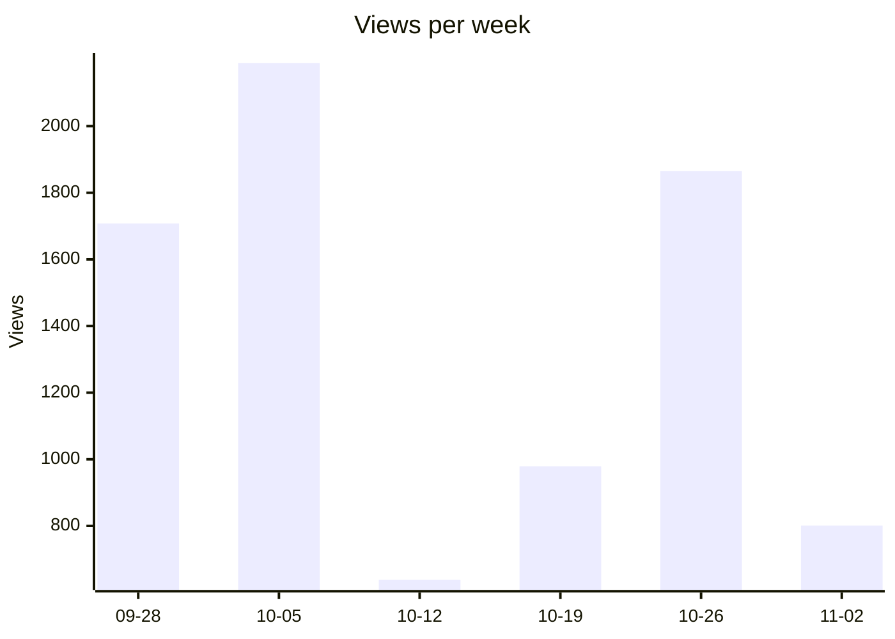
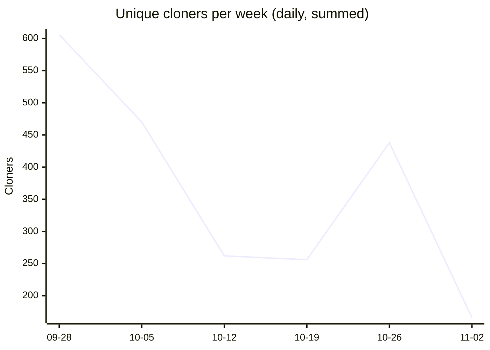
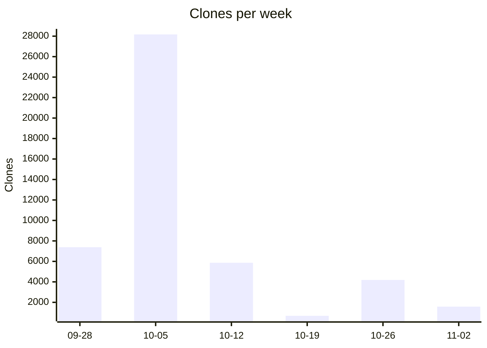

# Repository traffic

GitHub keeps traffic data for 14 days only; `scripts/traffic_stats.py` archives it into the CSVs in this folder. Daily unique counts do not add up to unique people over a period, and CI or mirrors inflate raw clones.

<!-- traffic:start -->
_Updated 2026-11-05 for `IBM/AssetOpsBench`. Archive covers 2026-09-30 to 2026-11-04. Weeks start Monday; the latest week may be partial._

| Metric | Archived total | Last 14 days |
|---|---:|---:|
| Views | 8,180 | 3,645 |
| Clones | 47,872 | 6,450 |
| Unique cloners (daily, summed) | 2,198 | 860 |

Missing archived dates: 2026-10-14, 2026-10-15, 2026-10-16, 2026-10-17, 2026-10-18, 2026-10-19, 2026-10-20, 2026-10-21. Archived totals and weekly charts include only recorded days; missing days are not zero traffic.

### Weekly views

### Weekly unique cloners (daily, summed)

### Weekly clones

### Clone spikes

Days above 5x the median clone count; usually CI or mirror pulls.

- 2026-10-01: 3,027 clones from 101 cloners
- 2026-10-03: 2,626 clones from 90 cloners
- 2026-10-10: 25,353 clones from 72 cloners
- 2026-10-13: 4,994 clones from 224 cloners

### Top referrers (last 14 days)

| Referrer | Views | Unique |
|---|---:|---:|
| Google | 158 | 98 |
| github.com | 138 | 96 |
| aocr.org | 104 | 104 |
| linkedin.com | 81 | 66 |
| com.linkedin.android | 28 | 26 |
| teams.public.onecdn.static.microsoft | 20 | 6 |
| Bing | 13 | 10 |
| huggingface.co | 13 | 8 |
| arxiv.org | 4 | 4 |
| research.ibm.com | 4 | 4 |

### Top pages (last 14 days)

| Path | Views | Unique |
|---|---:|---:|
| `/IBM/AssetOpsBench` | 1245 | 412 |
| `/IBM/AssetOpsBench/stargazers` | 323 | 1 |
| `/IBM/AssetOpsBench/pulls` | 148 | 18 |
| `/IBM/AssetOpsBench/tree/main` | 73 | 27 |
| `/IBM/AssetOpsBench/issues` | 60 | 28 |
| `/IBM/AssetOpsBench/blob/main/README.md` | 52 | 19 |
| `/IBM/AssetOpsBench/tree/main/src` | 47 | 21 |
| `/IBM/AssetOpsBench/blob/main/INSTRUCTIONS.md` | 46 | 20 |
| `/IBM/AssetOpsBench/tree/main/docs` | 29 | 13 |
| `/ibm/assetopsbench` | 25 | 12 |

<!-- traffic:end -->
